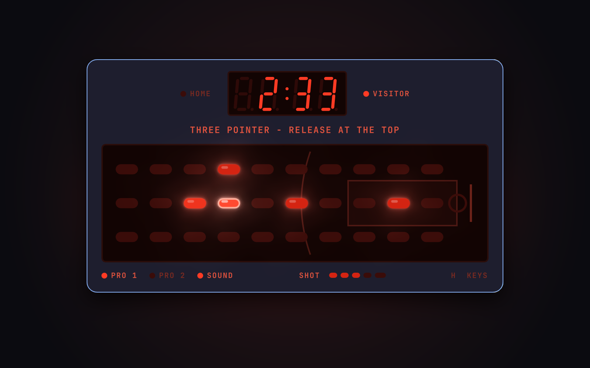

# LED Hoops

A retro handheld LED basketball game for [Omarchy](https://omarchy.org/), and the companion to
[LED Gridiron](https://github.com/jameydavis/led-gridiron). Glowing red players on a three-lane half
court, a 7-segment scoreboard, a shot meter, a 24-second shot clock, and piezo beeps, all running
inside the Omarchy shell.



You're the bright player and your teammate blinks. Work the ball past three defenders, then hold to
rise for a shot and let go when the shot meter peaks. One player runs both teams' offense against
the computer defense, or two players pass the keyboard back and forth on each change of possession.

## Install

```bash
omarchy plugin add https://github.com/jameydavis/led-hoops.git --enable
```

Click the basketball icon in the bar to play. To open it from a key, add a binding in
`~/.config/hypr/bindings.lua` that runs:

```bash
omarchy-shell jameydavis.led-hoops toggle
```

## Keys

| Key | Button |
| --- | --- |
| `W` `A` `S` `D` (or arrows) | Dribble one step per press. The first move starts the clock |
| `Space` | **Shoot**: hold to rise, and the shot meter climbs and falls. Let go when the top light is lit |
| `E` | **Pass** to your teammate, and you take control of them. A defender in the passing lane steals it |
| `Q` | **Status**: after a basket or turnover, sets up the next possession. Tap to see the shot clock and game clock; hold to keep them up |
| `R` | **Score**: Home and Visitor. Tap for a quick look, hold to keep it up |
| `1` / `2` | **Pro 1** (slower defense that misses more steals) / **Pro 2** (fast, grabby defense and a quicker shot meter) |
| `P` | Pause |
| `M` | Sound on/off |
| `N` `N` | New game (press twice) |
| `H` | Show or hide the key legend under the court |
| `Esc` | Close (a possession in progress is paused) |

## Rules

- Four 3:00 quarters on a real-time clock, and a 24-second shot clock. A tie goes to 1:00 overtimes.
- Shots from beyond the painted arc are worth 3, everything else 2. Layups go in most often.
- Your release timing matters most. A defender next to you lowers the odds, and one standing between
  you and the rim can block the shot.
- Misses carom off the rim, and whoever is closest grabs the rebound. An offensive rebound keeps play
  going with a fresh shot clock.
- A defender who steps onto you reaches in for a steal.
- After every basket, turnover or violation, the court freezes until you press STATUS (`Q`). The other
  team then inbounds from the left edge.
- A shot still in the air when the horn sounds counts.

## Requirements

- Omarchy with the Quickshell-based `omarchy-shell`
- Qt's `QtQuick.Effects` (MultiEffect) for the LED glow and `QtQuick.Shapes` for the court markings,
  both part of Qt 6 and already used by the Omarchy shell
- `pw-play` / `pw-cat` (PipeWire, standard on Omarchy) for sound. While the game is open, it holds a
  silent stream so the audio output doesn't fall asleep between plays and swallow beeps.

No network access, no files written, and no changes to your configuration beyond what
`omarchy plugin add` / `enable` themselves do.

## Development

```bash
node test/logic.test.js        # rules engine tests, including fuzzed full games
python3 tools/gen_sounds.py    # rebuild sounds/*.wav from the synth recipes
omarchy plugin validate .
```

`Logic.js` holds the rules (plain JS, no QML). `BarWidget.qml` runs the timers, input, sound and the
device face. `Court.qml` draws the LED court and its markings, and `SevenSeg.qml` draws the
scoreboard digits.

## Uninstall

```bash
omarchy plugin remove jameydavis.led-hoops
```

## License

MIT. An original game inspired by the handheld LED sports games of the late 1970s. It is not
affiliated with or endorsed by any toy or game company.
